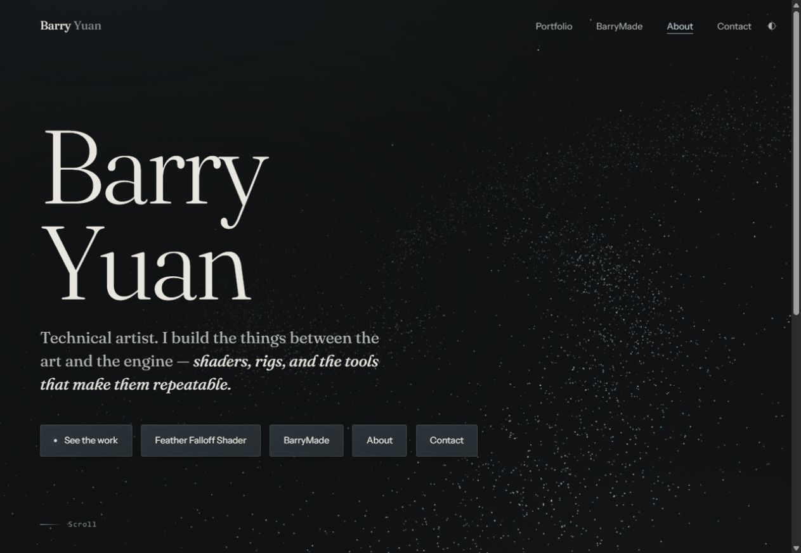
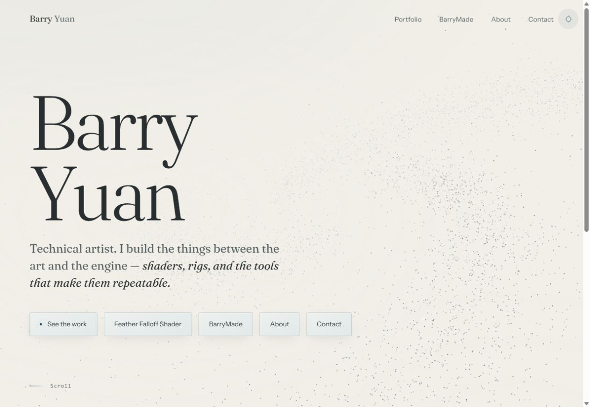
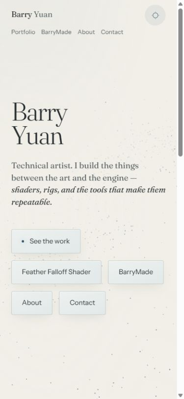
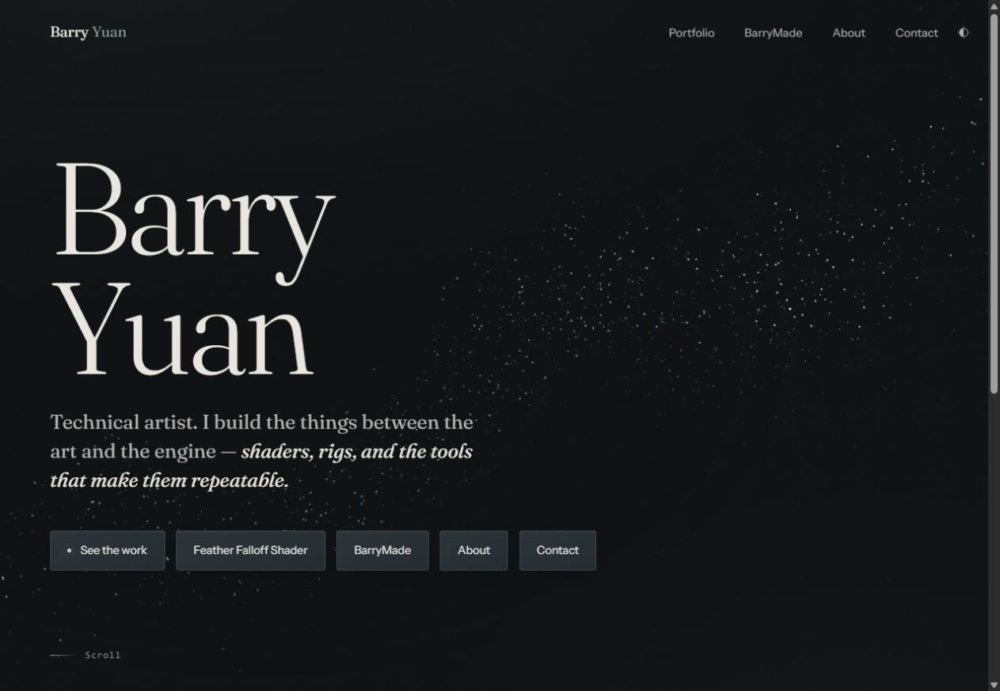

# Homepage galaxy prototype

## Cinematic entrance prototype — 2026-10-27

Node discovery refinement: the three-line trajectories and camera are unchanged.
Navigation grains and annotations stay dormant through the three-second entrance,
then grains fade in over 700ms. At rest, only a sparse subset is visible at low
opacity and three times the cluster spread. Pointer proximity (35–140 CSS pixels)
smoothly condenses a restrained formation; hover/focus/touch selection reveals its
label through the existing discovery controller. Exit reverses the response with
5/s exponential damping. Native click targets, keyboard focus and two-tap touch
navigation remain intact. Reduced motion paints selection directly without RAF.
The preserved approved comparison renderer intentionally retains its old nodes.

The default renderer now uses a three-second entrance: three sparse particle
traces (0–0.5s), curving and intersecting paths with increasing depth (0.5–1.3s),
a forward camera move as those same grains spread into their original 3D homes
(1.3–2.2s), then a smooth return to the approved composition (2.2–3.0s).
There is no radial explosion, plane rotation, new geometry, bloom, or extra draw
call. All four original attribute buffers remain identical. The three navigation
formations bypass the trace deformation and remain at their clickable home
positions during the camera movement. Palette, typography and navigation code
are unchanged. Reduced motion goes directly to the final neutral galaxy.

Pointer tilt and local repulsion fade in over 700ms after the camera settles;
navigation hover/focus remains available immediately. Hidden/offscreen time is
paused; context restoration skips the entrance. The approved pre-prototype
renderer is preserved byte-for-byte in `assets/js/field-galaxy-approved.js`.
The sections below describe earlier iterations, including the approved intro.

Run `node scripts/preview.cjs` (or use the already-running server on port 8080).

| Local URL | View |
| --- | --- |
| `http://127.0.0.1:8080/` | New cinematic intro; reload to replay |
| `http://127.0.0.1:8080/?intro=approved` | Approved intro and interactions before this prototype |
| `http://127.0.0.1:8080/?intro=final` | Final interactive composition, entrance skipped |
| `http://127.0.0.1:8080/?introAt=0.4` | TRACE still |
| `http://127.0.0.1:8080/?introAt=1.1` | FLOW still |
| `http://127.0.0.1:8080/?introAt=1.8` | SPATIAL REVEAL still |
| `http://127.0.0.1:8080/?introAt=2.6` | SETTLE still |

Comparison parameters only work on loopback hosts. Still previews freeze the
particle clock, not the page UI. `?reveal=open` remains available for the older
opened pose. No commit, push or deployment is part of this prototype.

Adjustable `CFG` controls in `field-galaxy.js`: `traceEndMs` 500, `flowEndMs` 1300,
`spatialEndMs` 2200, `introMs` 3000, `entranceCameraStart` +2.2 world units,
`entranceCameraPush` 2.6 world units forward, `entranceDepth` 7 world units, and
`entranceHandoffMs` 700. Keep the timing boundaries in ascending order. Trace
width (22), curvature (2.2), drift rate (0.85) and sparsity are in the vertex
shader. Existing pointer limits and damping remain unchanged.

Verification: `node scripts/test-galaxy.cjs`, `node scripts/test-cosmos-nav.cjs`,
JavaScript syntax and whitespace checks pass. Tests cover exact particle-buffer
preservation, camera bounds, fixed intro orientation, projected node alignment
through the camera travel, pointer handoff, reduced motion, context restoration,
cleanup and loopback-only comparisons, alongside the approved renderer tests.
Chrome rendered TRACE in light mode and FLOW/SPATIAL in dark mode without captured
shader warnings/errors. Browser recording is not exposed by the available tools;
`galaxy-preview/cinematic-spatial.png` is a timestamped review still instead.
Continuous motion feel, real touch hardware, other browsers and GPU performance
remain manual verification items; automated lifecycle tests use mocked WebGL.

Local, uncommitted experiment, 2026-10-26. BarryMade, all other pages, hero identity,
top navigation, shared styles/scripts, and the original physics audit are unchanged.

## Preview

Run `node scripts/preview.cjs` from the repository root, then open:

- Prototype: http://127.0.0.1:8080/
- Original: http://127.0.0.1:8080/?galaxy=legacy
- Preserved first 3D prototype: http://127.0.0.1:8080/?galaxy=spatial
- Hold the opened pose for local review: http://127.0.0.1:8080/?reveal=open

The existing server's startup message mentions BarryMade; use the homepage URLs
above. Legacy selection works only on localhost / loopback. There are no visible
debug controls. Reload to replay the entrance. Only one renderer is loaded.

## Personal cosmos / celestial navigation

The homepage now embeds three navigable particle formations directly in the
galaxy: a warmer dense knot for Portfolio, a looser cool filament for BarryMade,
and a small paired cluster for About Me. The CSS planet surfaces, rings and moon
artwork are removed. Each formation consists of 192 seeded grains in the same
WebGL buffers, draw call and fragment shader as the surrounding stars. They share
perspective, depth fog, galactic tilt, reveal, drift, palette and local cursor
illumination. Their halos are dispersed grains, not painted glows. The hero button row is
removed and replaced by a quiet “Explore the stars” hint. Names and descriptions
are hidden at rest on every viewport. Hover and keyboard focus reveal a single
annotation with the destination, description and “Explore →”, brighter surfaces,
and a local response in the existing WebGL particle field. HTML supplies invisible
native-link hit targets and the annotation only. The renderer projects each 3D
center and moves its target to match; it pins projected centers during selection
so the destination does not drift away from a click. Compact layouts retain a
stable lower constellation while still rendering real depth within each cluster.
The original galaxy data and opening sequence remain intact. No second renderer,
extra draw call, or continuous UI animation loop is introduced.

At widths up to 980px the constellation occupies its own space below the hero
introduction, with stable touch targets. Touch/pen input uses first tap to reveal,
second tap (including on the revealed Explore text) to navigate. Tapping another
body reveals that body first; tapping outside or Escape dismisses the annotation.
The same link contains the body and annotation, so moving between them does not
cross a hover boundary. Switching targets hides the outgoing annotation before
the next appears. Ordinary exit fades it away. Illumination uses the existing
damped particle response; annotation fade takes 280ms after a 90ms delay. Reduced
motion keeps a still formation and repaints focus illumination without RAF.

`assets/js/cosmos-nav.js` owns discovery independently of WebGL. Its capture-phase
click handler cancels the first touch before `site.js` can start a page transition.
Native mouse, modifier-click, keyboard and assistive-tech activation are preserved.
Named links, expanded state, and a fine focus ring support keyboard navigation.
The renderer subscribes to `cosmoschange` rather than owning a separate hover/focus
state. No frame loop is added. Without WebGL, all discovery behavior still works;
without JavaScript, native links navigate directly and CSS offers hover/focus reveal.
Without WebGL (and in legacy comparison modes), sparse CSS dust points mark the
otherwise invisible targets. They are hidden whenever the GPU formations render.

Gold is added in two spatial dust pockets in the vertex/fragment shader, with
palette-specific gold values for dark and light backgrounds. It does not tint
the entire canvas. `CFG.goldStrength` (0.82) tunes the pigment mix and
`CFG.beaconRadius` (2.4) tunes focus/hover illumination. Body sizes, resting
positions and annotation spacing are scoped to `.cosmos` / `.celestial` in `hero.css`.
`CFG.clusterCount` tunes grains per destination; cluster shapes are defined in the
geometry section. The 576 added grains bring totals to 16576 desktop / 6176 mobile.
Original position, seed, and material buffers still pass preservation checks.

This refinement changes only `index.html`, `assets/css/hero.css`, the existing
renderer/loader, the new discovery controller, regression tests, this note, and
screenshots. BarryMade and shared styles/scripts are unchanged. Run
`node scripts/test-cosmos-nav.cjs` for idle, exclusive selection, hover exit,
focus, Escape, first/second tap, outside tap, cancellation, modifier/keyboard
activation, BFCache and cleanup tests. `node scripts/test-galaxy.cjs` covers
renderer lifecycle, unchanged particle data, beacon activation and reduced-motion
repaint. These use mocked APIs. Physical touch-device and cross-browser testing
remain outstanding. No build system or lint configuration is present; syntax is
checked with `node --check` and whitespace with `git diff --check`.

Discovery browser verification in Chrome (previous pass): no captured console errors; all three
idle annotations have computed visibility `hidden`; pointer entry reveals one
annotation; keyboard focus reveals the same annotation with a restrained ring;
all three links navigate to their correct routes, including Portfolio via Enter;
Back restores the homepage. A 390 × 844 viewport verified hidden mobile labels,
roughly 109px-wide hit areas, and light-mode focus presentation. The native touch
sequence is tested with mocked pointer/click events, not a physical touchscreen.
OS reduced-motion changes and other browser engines were not rerun in this pass.

Particle-integration verification: syntax, discovery tests and renderer lifecycle
tests pass. New tests verify three tagged formations in the shared buffers, finite
GPU data, unchanged original particles, and agreement between projected centers
and link targets. Chrome compiles/renders the updated shaders without captured
errors and keyboard focus reveals the matching grain formation. Mobile light-mode
rendering and the BarryMade route via keyboard were checked in Chrome; snapshots
include `galaxy-preview/clusters-mobile-light.png`. Tests also verify that fallback
markers return on context loss and disappear after restoration. Physical touch
hardware, real context loss and hardware performance remain unmeasured.

Particle screenshots: `galaxy-preview/clusters-idle.png` and
`galaxy-preview/clusters-focus.png`. Discovery screenshots retain the earlier
planet-artwork iteration. Earlier cosmos images show the superseded
permanently labelled version. The legacy/spatial URLs compare particle
renderers; the new HTML celestial links remain present in those comparison modes.
Mobile snapshots are `discovery-mobile.png` and `discovery-mobile-light.png`.

## Z-tilt reveal details

The first 3D prototype is saved unchanged in `field-spatial.js`. The current
renderer preserves every original spiral position, seed, and material value;
the automated test compares all those values against that snapshot.

After formation, a single opening beat couples Z roll with increased disk
inclination and camera pullback. This exposes more of the galactic plane instead
of merely rotating its diagonal silhouette. A wider, slightly warped disk and
a distant starfield occupy independent 3D positions. The distant stars rotate
more slowly, giving the opening a spatial reference. Additional stars emerge
gradually; the original spiral stays present throughout.

The opening now owns the pose exclusively through 12800ms. Its quintic envelope
returns exactly to rest without a second smoothing tail, then pointer influence
fades in over 1400ms. Pointer movement no longer reopens the galaxy or changes
camera distance or Z roll. It supplies at most 0.045 radians of yaw and 0.025
radians of pitch about the galaxy's model center, with exponential damping at
3.2/s. Normalized input keeps the limits consistent across viewport shapes.
Distant stars receive only 8% of pointer yaw and 18% of pitch. Touch retains local
illumination without steering; exit, blur and scroll return the tilt to neutral.
Reduced motion retains the existing still, partially opened composition.

Reveal tuning in `CFG`: `revealTilt` (0.58 radians), `revealRoll` (0.18 radians),
`revealPullback` (6.4 world units), and the one-time window
`revealStartMs` / `revealEndMs` (4800 / 12800). The camera pullback is intentional:
it brings more of the plane into the viewport while keeping perspective.

One new grain per three original particles adds 4000 desktop / 1400 mobile
particles, for totals of 16000 / 5600, still in a single draw call. There is one
additional static attribute buffer and no second renderer. The extra populations
are interleaved so the mobile budget contains the same spatial layers.

Motion refinement checks: syntax, navigation and lifecycle tests pass, including
original-particle preservation, pointer isolation during intro, bounded tilt,
fixed camera/roll, projected navigation alignment during tilt, pinned selected
formations, touch behavior, neutral return and equal damping at 30/120 Hz.
Chrome rendered the updated shader with no captured warnings/errors. Continuous
pointer feel and hardware timing remain manual review items.
Earlier screenshots below document the first prototype; `reveal-dark.png` records
the refined opening.

## Implementation

`assets/js/field.js` selects the renderer. `field-legacy.js` preserves the old
implementation unchanged. `field-galaxy.js` adapts its raw WebGL shaders, static
buffers, perspective projection, grain materials, palette variables, cursor
repulsion, cursor illumination, and parallax. No dependencies or build step.

The prototype distributes seeded particles into three loose spiral arms in a
thick, tilted disk, with scattered halo grains. A compact opening expands with
radial overshoot, curves into the disk, and settles into differential orbital
motion plus quiet drift. Each particle has slightly different timing. This is
analytic, gravitationally inspired motion, not an N-body gravity simulation.
The galaxy never intercepts navigation or waits for its entrance to complete.

Cursor forces intersect the pointer ray at each particle's depth. Exponential
damping makes response consistent across frame rates. Touch release/cancel and
scroll clear stale forces. The original small grain palette and CSS text wash
remain in use; there is no bloom pass.

One managed RAF loop pauses for hidden tabs, offscreen canvas, context loss and
page suspension. Reduced motion draws a still settled galaxy, including after
visibility changes, resize, and theme switching. Context restoration rebuilds
only GPU resources and listeners without reloading the page or replaying the
burst. Final page teardown deletes buffers/program/shaders and listeners.

## Tuning

Edit `CFG` near the top of `field-galaxy.js`:

| Parameter | Default | Effect |
| --- | --- | --- |
| count / mobileCount | 12000 / 4200 | Desktop/mobile draw count; breakpoint 760 CSS px |
| radius | 13.5 | Disk extent |
| thickness | 0.38 | Disk thickness, with additional halo spread |
| tilt | 0.40 radians | Disk inclination |
| orbitSpeed | 0.018 | Differential rotation |
| pointerYaw / pointerPitch | 0.045 / 0.025 radians | Maximum model tilt |
| pointerResponse | 3.2 per second | Frame-rate-independent damping |
| pointerHandoffMs | 1400 | Influence fade after the reveal settles |
| maxDpr | 1.75 | Backing-store resolution cap |
| pushRadius / pushForce | 2.6 / 1.35 | Cursor clearing region and strength |
| introMs | 4800 | Formation duration |

Spiral arm scatter, halo fraction, roll, and formation overshoot are documented
in the geometry/shader sections. Keep camera distance and the cursor projection
constant in the shader synchronized if changing `camZ`.

## Verification and limits

- Passed `node --check` for all three renderer scripts and `git diff --check`.
- Passed `node scripts/test-galaxy.cjs`: intro completion, pointer response,
  mobile count/backing resolution, offscreen pause, single-loop resume,
  live reduced motion, visibility changes, theme repaint, BFCache lifecycle,
  context restoration, final cleanup, missing WebGL and shader-failure fallback.
  These are Node VM tests with mocked browser/WebGL APIs, not GPU tests.
- Chrome: actual shader rendering with no captured warning/error logs; settled
  desktop dark/light views; 390 × 844 mobile light view; resize back to desktop;
  theme toggle; About navigation and browser Back; legacy mode rendering and
  selected script verified. Screenshots are in `docs/galaxy-preview/`.
- Live browser automation had intermittent connection delays. Precise intro
  timing and pointer feel need human review. No trustworthy FPS/GPU timing was
  collected. Static buffers, one draw call per frame, responsive particle counts,
  capped DPR and offscreen suspension bound the work, but are not a hardware
  performance measurement.
- Real OS reduced-motion changes, touch hardware, GPU context loss, WebGL-disabled
  browser startup, Firefox/Safari, and low-end mobile performance remain manual
  verification items. Mobile was viewport emulation, not a phone.
- Legacy mode intentionally retains its historical lifecycle issues, including
  the audit's reduced-motion resume bug, for an unchanged comparison.
- Long-running differential rotation gradually winds the arms; tune orbitSpeed
  after reviewing several minutes of idle motion. No deploy/commit/push occurred.

